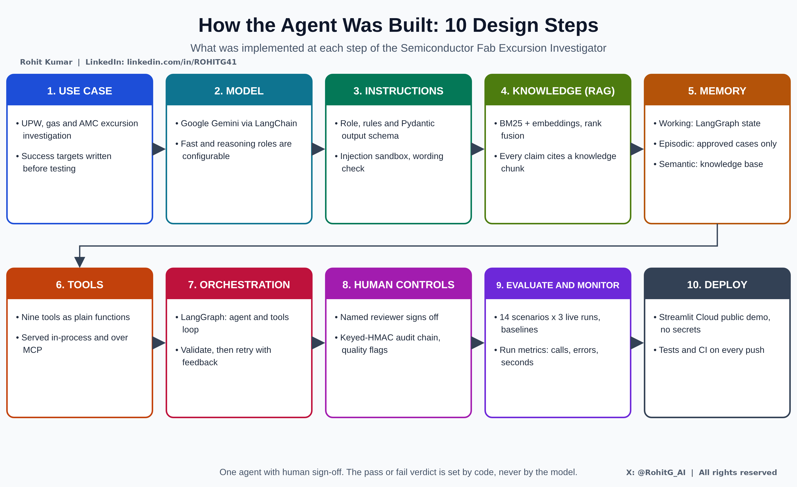

# Semiconductor Fab Excursion Investigator

**Find the likely cause of a water or gas excursion faster. The AI proposes, code decides pass or fail, and a named engineer signs.**

*Codename: FAB-SENTRY*

> **Prototype built and evaluated on simulated fab data. Next step: a pilot on real fab data.
> Fab teams interested in piloting it are welcome to get in touch.**

---

# For fab, utilities and facilities teams

## The problem

When an ultra-pure-water (UPW), bulk-gas or airborne-molecular-contamination (AMC) alarm fires in a fab, an engineer has to find out *what changed*:
a resin bed, a UV lamp, a sensor fault, a recent maintenance job. The evidence is spread across sensor trends, alarms, maintenance logs, handover notes
and O&M guidance, and the first hours of an excursion are spent collecting it by hand. An AI model can speed that up, but a fab cannot accept a language
model deciding whether a reading passes.

## What this gives your team

- **A faster first look:** the investigator reads the alarm, sensor history, maintenance records and guidance, and drafts a likely root cause with the evidence behind it.
- **A pass or fail the AI cannot change:** guard-band and calibration logic in plain code decides PASS, INDETERMINATE or FAIL, taking instrument uncertainty into account.
- **A draft that is checked first:** numbers must match the tool results, wording must not give orders, citations must exist, and the named cause must be backed by evidence.
- **An honest view of the evidence:** if a tool is offline or the data is thin, the report says so and flags it for the reviewer.
- **A decision trail:** a named engineer approves, rejects or asks for more evidence. Each decision is recorded in a tamper-evident audit chain and a PDF dossier.

## What it found in testing

On **14 simulated excursions, run 3 times each with live Gemini (42 runs)**, the investigator named the correct root cause in **41**.
It never gave a wrong cause with high confidence. When a data tool was offline, it flagged the gap every time. A hand-written rules engine, by comparison, failed every one of the four harder scenarios.
All data is simulated, so this shows the method works on known cases. It is not a claim about your fab, which is what a pilot is for.

## See it in 60 seconds

1. Open the **[live demo](https://semiconductor-fab-excursion-investigator-rohit-kumar-g.streamlit.app/)** and pick an alarm scenario in the left sidebar.
2. Choose **Replay** (a recorded live Gemini run) or **Scripted offline demo** (rules, no AI) and press **Run investigation**.
3. Read the verdict (set by code), the draft cause (from the AI) and the evidence behind it, then download the PDF dossier.

Worth trying:
- **S07:** a UV lamp wearing out while an operator note tries to hide it. The note is withheld and the cause is still found.
- **S12:** a sensor fault while its calibration is still valid. The cause is not the obvious one.
- **S13:** a data tool is offline and the report says so instead of guessing.

## Pilot and collaboration

Run a semiconductor fab, a utilities team or a facilities group? Let us test this on your own data.

- **What I would need:** a read-only export of UPW or gas sensor history plus maintenance records. No live connection to your fab.
- **What you get:** the same investigator run on your data, with a scored report like the one described here.
- **Also open to:** feedback from fab, cleanroom and facilities engineers, and collaboration on evaluation design.

**Contact:** Rohit Kumar, PMP, CEng (India), CEA, FSEr (TÜV) | Email: [grohit41@gmail.com](mailto:grohit41@gmail.com) | [LinkedIn: ROHITG41](https://www.linkedin.com/in/ROHITG41) | X: [@RohitG_AI](https://x.com/RohitG_AI)

---

# For the AI and engineering community

## System architecture

| Stage | What happens |
|---|---|
| **1. Ingress** | Alarm, sensor history, maintenance logs and operator notes come in. Notes and free text returned by tools are scanned for prompt injection. |
| **2. Deterministic code** | Guard-band and calibration logic gives the PASS / INDETERMINATE / FAIL verdict. It goes straight to the dossier with no AI step in between. |
| **3. AI agent (Gemini)** | A LangGraph loop lets the model call nine tools (in-process and over MCP), retrieve from a hybrid RAG knowledge base, use three memory tiers and draft a root cause. |
| **4. Validator** | Checks numbers, wording, citations and that the named cause is a supported hypothesis. A failed check sends feedback to the agent for one retry. |
| **5. Human sign-off** | A named reviewer decides. The decision is chained with a keyed HMAC and a draft or signed PDF dossier is produced. Approved cases feed episodic memory. |

It is a **single agent with human sign-off**, not a multi-agent system.

## How the agent was built: 10 design steps

| Step | What was implemented |
|---|---|
| 1. Use case | UPW, gas and AMC excursion investigation. Success targets were written before any testing (`evalkit/targets.json`). |
| 2. Model | Google Gemini through LangChain, with separate fast-loop and reasoning roles. The recorded evaluation used `gemini-3.5-flash-lite` for both. |
| 3. Instructions | A prompt module, a Pydantic v2 output schema, a prompt-injection sandbox and a directive-wording check. |
| 4. Knowledge (RAG) | Hybrid BM25 + embedding retrieval with reciprocal rank fusion over an O&M knowledge base. Citations are checked by the validator. |
| 5. Memory | Working (LangGraph state), episodic (human-approved cases only) and semantic (the knowledge base). |
| 6. Tools | Nine tools written once as plain functions, served in-process and over MCP stdio. |
| 7. Orchestration | A LangGraph loop: ingress, agent and tools, draft, validate, finish, with a retry that feeds validation errors back to the model. |
| 8. Human controls | Named-reviewer sign-off, evidence-quality flags to acknowledge, and a keyed-HMAC audit chain. |
| 9. Evaluate and monitor | 14 scenarios x 3 live runs scored against hidden ground truth, with one-shot and rules baselines, Wilson intervals and per-run metrics (tool calls, errors, rounds, seconds). |
| 10. Deploy | A read-only public demo on Streamlit Community Cloud with no secrets, plus 141 tests and GitHub Actions on every push. |

## Technology stack

- **Runtime and UI:** Python 3.12, Streamlit Community Cloud
- **Agent and LLM:** LangGraph, LangChain, Google Gemini, MCP stdio tool server
- **Deterministic core:** Pydantic v2, NumPy, Pandas, BM25 + embedding retrieval with reciprocal rank fusion, keyed-HMAC audit chain, ReportLab PDF engine
- **Quality:** pytest, GitHub Actions, a scored evaluation harness

## What it contains

- **Simulated fab:** 14 scenarios with known root causes (10 core, 4 hard) generated by `simulator.py`
- **Guard-band and calibration logic**, deterministic (`guardband.py`)
- **Guardrails:** prompt-injection sandbox for operator notes and tool text, numeric-consistency validator, directive-wording check, citation check
- **Nine tools**, **hybrid retrieval**, **three memory tiers**, **human sign-off** with a keyed-HMAC audit chain
- **Run metrics** on every run, shown in the app and the PDF
- **PDF dossier** in draft and signed variants
- **Streamlit UI** with Replay, Scripted offline and Live Gemini modes (the public demo shows the first two)

## Evaluation results (simulated data, 23 November 2026)

14 simulated scenarios x 3 live runs each, scored by code against ground truth the model never sees. Targets were written before measuring.

| Method | Root cause correct (42 runs) | 95% range | Passed the validator |
|---|---|---|---|
| **Agent** (model chooses tools) | **41 / 42** (30/30 core, 11/12 hard) | 88-100% | 41 / 42 |
| One-shot (fixed tool plan, one model call) | 40 / 42 (30/30 core, 10/12 hard) | 84-99% | 38 / 42 |
| Rules engine (hand-written) | 30 / 42 (30/30 core, 0/12 hard) | 56-83% | 42 / 42 |

- Agent and one-shot are **not statistically different** on cause accuracy. The rules engine fails every hard scenario.
- Injection scanner: 9/9 direct attacks caught, 0/6 evasive ones caught. The live model followed none of the six evasive attacks. Verdicts come from code and cannot be changed by notes.
- The author wrote the simulator, the scenarios and the knowledge base, so this is a method check on simulated data, not a measure of real-fab performance.

Technical documentation is available on request, and in the repository: [setup](docs/SETUP_Claude.md), [evaluation method and commands](docs/EVALUATION_Claude.md), [scope and limits](docs/LIMITS_Claude.md).

---

## Author & Architect

**Rohit Kumar, PMP, CEng (India), CEA, FSEr (TÜV)**  
Mission-Critical Infrastructure & Systems Engineering Specialist, New Delhi

Copyright (c) 2026 Rohit Kumar. All rights reserved.
This repository is published for viewing and evaluation. Reuse, redistribution or commercial use requires written permission.
For pilots, collaboration or licensing, please reach out by email at [grohit41@gmail.com](mailto:grohit41@gmail.com), on [LinkedIn](https://www.linkedin.com/in/ROHITG41) or on X ([@RohitG_AI](https://x.com/RohitG_AI)).

