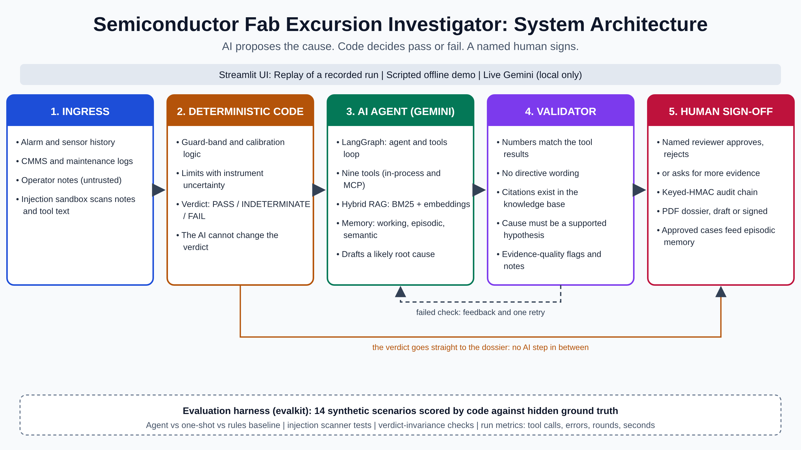

<div align="center">

# Semiconductor Fab Excursion Investigator

**AI proposes the cause. Code decides pass or fail. A named human signs.**

An assistive investigator for ultra-pure-water (UPW), bulk-gas and airborne-molecular-contamination (AMC) excursions in a semiconductor fab.

[](https://semiconductor-fab-excursion-investigator-rohit-kumar-g.streamlit.app/)


[](https://github.com/ROHITG41/Semiconductor-Fab-Excursion-Investigator/actions/workflows/tests.yml)


[](https://www.linkedin.com/in/ROHITG41)

*Codename: FAB-SENTRY*

</div>

> **Dataset note:** all data in this repository is synthetic and generated by `simulator.py`.
>
> **Prototype built and evaluated on synthetic fab data. Next step: a pilot on real fab data.
> Fab teams interested in piloting it are welcome to get in touch.**

---

## Executive Problem Statement

When an ultra-pure-water (UPW), bulk-gas or airborne-molecular-contamination (AMC) alarm fires in a semiconductor fab, an engineer has to find out
*what changed*: a resin bed, a UV lamp, a sensor fault, a recent maintenance job. The evidence is spread across sensor trends, alarms, maintenance logs,
handover notes and O&M guidance, and the first hours of an excursion are spent collecting it by hand. An AI model can speed that up, but a fab cannot accept
a language model deciding whether a reading passes. This prototype shows how to get the speed **without giving the AI the verdict**.

## Operational Value

- **Faster first look:** the agent reads the alarm, sensor history, maintenance records and knowledge base, and drafts a likely root cause with the evidence behind it.
- **A verdict the AI cannot change:** guard-band and calibration logic in plain code decides PASS, INDETERMINATE or FAIL, taking instrument uncertainty into account.
- **Checked before a human sees it:** a validator rejects drafts with numbers that do not match the tool results, directive wording, missing citations, or a cause no evidence supports. Evidence-quality flags are shown for a reviewer to acknowledge.
- **Traceable decisions:** a named reviewer approves, rejects or asks for more evidence, and each decision goes into a keyed-HMAC audit chain and a PDF dossier.
- **Measured, not assumed:** 14 synthetic scenarios scored by code against hidden ground truth, with baselines and pre-registered targets.

## System Architecture

<p align="center"></p>

| Stage | What happens |
|---|---|
| **1. Ingress** | Alarm, sensor history, maintenance logs and operator notes come in. Notes and any free text returned by tools are scanned for prompt injection. |
| **2. Deterministic code** | Guard-band and calibration logic gives the PASS / INDETERMINATE / FAIL verdict. It goes straight to the dossier with no AI step in between. |
| **3. AI agent (Gemini)** | A LangGraph loop lets the model call nine tools (in-process and over MCP), retrieve from a hybrid RAG knowledge base, use three memory tiers and draft a root cause. |
| **4. Validator** | Checks numbers, wording, citations and that the named cause is a supported hypothesis. A failed check sends feedback to the agent for one retry. |
| **5. Human sign-off** | A named reviewer decides. The decision is chained with a keyed HMAC and a draft or signed PDF dossier is produced. Approved cases feed episodic memory. |

It is a **single agent with human sign-off**, not a multi-agent system. The evaluation harness (`evalkit`) sits beside the pipeline and is not part of a run.

## Technology Stack

- **Runtime and UI:** Python 3.12, Streamlit Community Cloud
- **Agent and LLM:** LangGraph, LangChain, Google Gemini (`gemini-3.5-flash-lite` in the recorded evaluation), MCP stdio tool server
- **Deterministic core:** Pydantic v2, NumPy, Pandas, BM25 + embedding retrieval with reciprocal rank fusion, keyed-HMAC audit chain, ReportLab PDF engine
- **Quality:** pytest (141 tests), GitHub Actions on every push, a scored evaluation harness

## Try the live demo in one minute

1. Open the [live app](https://semiconductor-fab-excursion-investigator-rohit-kumar-g.streamlit.app/) (or use the badge above) and pick an alarm scenario in the left sidebar.
2. Choose **Replay** (a recorded live Gemini run) or **Scripted offline demo** (rules, no AI), then press **Run investigation**.
3. Read the verdict (set by code), the draft cause (from the AI), and the evidence behind it.
4. Download the PDF dossier.

Worth trying:
- **S07**: an instruction hidden in the operator notes is withheld from the model.
- **S12**: a sensor fault while its calibration is still valid. The cause is not the obvious one.
- **S13**: a tool is offline and the report says so instead of guessing.

The public demo has no Live Gemini mode, no sign-off and no shared state, so it is safe to click around.

## What it contains

- **Synthetic fab simulator**: 14 scenarios with known root causes (10 core, 4 hard)
- **Guard-band and calibration logic**, deterministic (`guardband.py`)
- **Guardrails**: prompt-injection sandbox for operator notes and for free text returned by tools, numeric-consistency validator, directive-wording check, citation check
- **Nine tools** as plain functions, served in-process (LangChain) and over MCP stdio
- **Hybrid retrieval** over a synthetic O&M knowledge base: BM25 + embeddings with reciprocal rank fusion
- **Three memory tiers**: working (LangGraph state), episodic (human-approved past cases only), semantic (knowledge base)
- **Human sign-off** and a keyed-HMAC, tamper-evident audit chain
- **Run metrics** on every run: tool calls, tool errors, agent rounds and elapsed seconds, shown in the app and the PDF
- **PDF dossier** in draft and signed variants, with author block and footer
- **Streamlit UI** with three clearly labelled modes: Replay, Scripted offline, Live Gemini

## How well does it work? (synthetic data, 23 November 2026)

14 synthetic scenarios x 3 live runs each, scored by code against ground truth the model never sees. Targets were written before measuring.

| Method | Root cause correct (42 runs) | 95% range | Passed the validator |
|---|---|---|---|
| **Agent** (model chooses tools) | **41 / 42** (30/30 core, 11/12 hard) | 88-100% | 41 / 42 |
| One-shot (fixed tool plan, one model call) | 40 / 42 (30/30 core, 10/12 hard) | 84-99% | 38 / 42 |
| Rules engine (hand-written) | 30 / 42 (30/30 core, 0/12 hard) | 56-83% | 42 / 42 |

What this does and does not show:
- On the core scenarios every method scores the same. On the **hard** scenarios the fixed rules fail every case.
- Agent and one-shot are **not statistically different** on cause accuracy (41/42 vs 40/42).
- No run gave a wrong cause with high confidence. When a tool was offline (S13) the evidence-quality flag was raised in 3 of 3 runs.
- One agent run named a cause without supporting evidence; a validator rule now rejects that.
- Injection scanner: 9/9 direct attacks caught, 0/6 evasive ones caught, 1/6 benign notes wrongly blocked. The live model followed none of the six evasive attacks (one run each). Verdicts come from code and cannot be changed by notes.
- The author wrote both the data and the knowledge base, which contains hints near some scenarios. Small samples, one model, one day.

**This is not evidence of performance on a real fab.** Full tables: [`EVAL_RESULTS_Claude.md`](EVAL_RESULTS_Claude.md).

## Run it on your own PC (Windows, VS Code terminal)

```
python -m venv .venv
Set-ExecutionPolicy -Scope Process Bypass
.venv\Scripts\activate
pip install -r requirements.txt
copy .env.example .env      (then add GEMINI_API_KEY and FAB_SENTRY_HMAC_SECRET)
python simulator.py
python check_setup.py
streamlit run app.py
```

- Create the HMAC secret with: `python -c "import secrets; print(secrets.token_hex(32))"`
- Record real runs for Replay mode: `python record_trace.py --scenario S01` (or `--all`)
- Public demo mode: set `FAB_SENTRY_PUBLIC_DEMO=1` (on Streamlit Cloud, under Secrets). Recorded runs come from `demo_traces/` (`python make_demo_traces.py`).

## Reproduce the evaluation

```
python -m evalkit scan                      # free: injection scanner + verdict-invariance checks
python -m evalkit run --kind rules          # free: rules baseline
python -m evalkit run --kind agent --scenarios all --max-calls 150
python -m evalkit run --kind oneshot --scenarios all --max-calls 60
python -m evalkit attacks-live --max-calls 60
python -m evalkit report                    # writes EVAL_RESULTS_Claude.md
```

Every model call is counted and spaced; when the budget is reached the batch stops and finished runs are kept.
Targets in `evalkit/targets.json` were fixed before measuring. Evaluation uses an empty scratch memory.

## How sign-off works

The reviewer enters a name and role and chooses Approve, Reject or Request more evidence. Approve is refused if the draft failed the
numeric-consistency check. Each decision is appended to a keyed-HMAC chain (`audit/chain.jsonl`); editing, removing or reordering an entry breaks verification.
Only an approved, unmodified run can enter episodic memory. The chain is **tamper-evident, not immutable**, and names are typed in without authentication:
it demonstrates the pattern and is not a validated electronic signature.

## Honest limits

- Alarm limits come from the project blueprint and are tagged *to be verified against the standard*. SEMI documents are paid and were not checked.
- The knowledge base is original synthetic guidance, not a SEMI standard or vendor documentation.
- Offline mode uses hashing embeddings, which retrieve less well than Gemini embeddings. No cross-encoder reranker.
- Injection scanning is pattern-based: a first line of defence, not a guarantee.
- The scripted offline demo uses rules, not AI. Its 10/10 result is a wiring check, not an accuracy claim.
- Not a safety-rated, GMP or 21 CFR Part 11 system. Streamlit Community Cloud storage is ephemeral.

## Pilot and collaboration

If you run a semiconductor fab, a utilities team or a facilities group and would like to see this on your own data:

- **What I would need:** a read-only export of UPW or gas sensor history plus maintenance records. No live connection to the fab.
- **What you get:** the same investigator run on your data, with a scored report like the one in this repository.
- **Also open to:** feedback from fab, cleanroom and facilities engineers, and collaboration on evaluation design.

**Contact:** Rohit Kumar, PMP, CEng (India), CEA, FSEr (TÜV) | Email: [grohit41@gmail.com](mailto:grohit41@gmail.com) | [LinkedIn: ROHITG41](https://www.linkedin.com/in/ROHITG41)

## Author & Architect

**Rohit Kumar, PMP, CEng (India), CEA, FSEr (TÜV)**  
Mission-Critical Infrastructure & Systems Engineering Specialist, New Delhi

---

<div align="center">

**Built by Rohit Kumar** | Mission-Critical Infrastructure & Systems Engineering Specialist, New Delhi

Copyright (c) 2026 Rohit Kumar. All rights reserved.
This repository is published for viewing and evaluation. Reuse, redistribution or commercial use requires written permission.
For collaboration, pilots or licensing, please reach out by email at [grohit41@gmail.com](mailto:grohit41@gmail.com) or on [LinkedIn](https://www.linkedin.com/in/ROHITG41).

</div>
